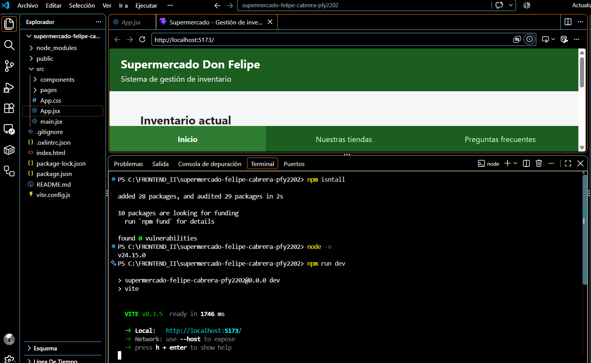
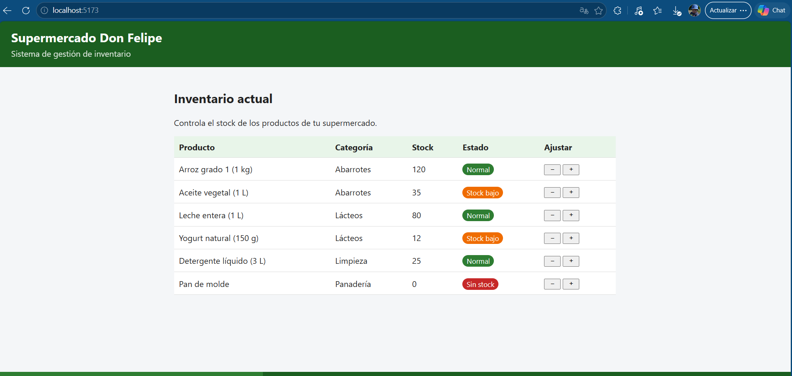
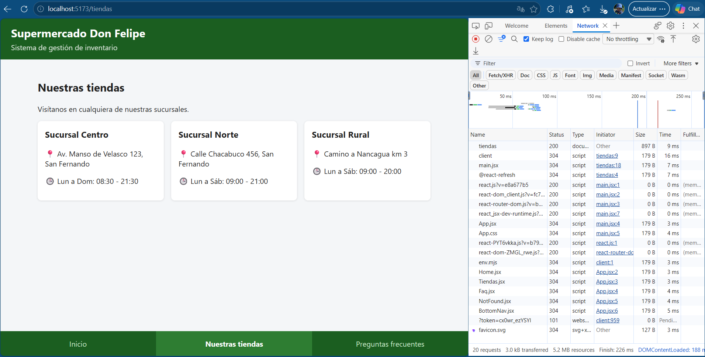
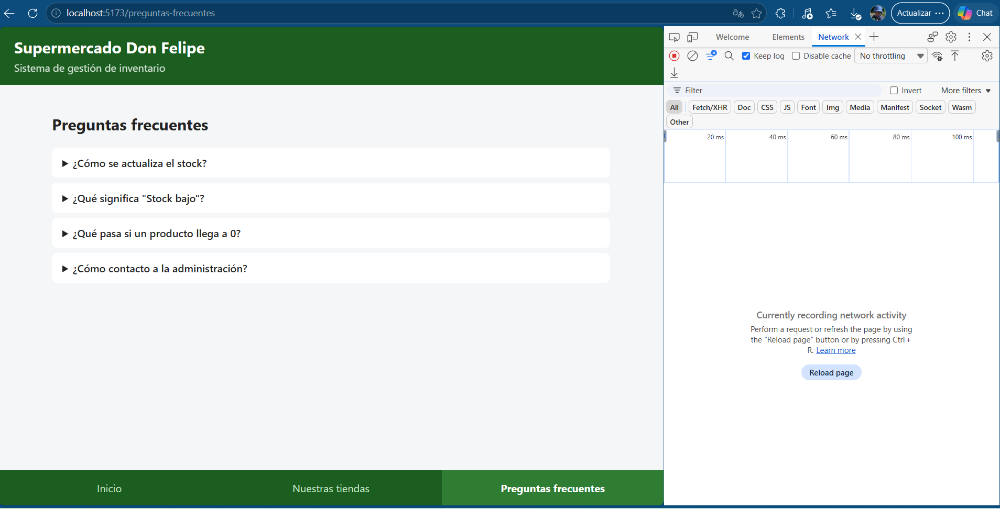
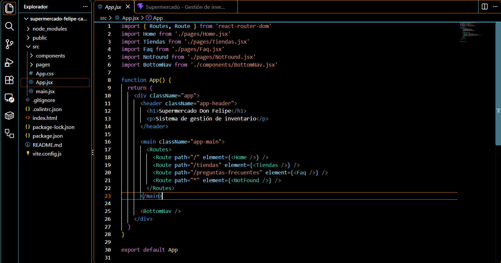
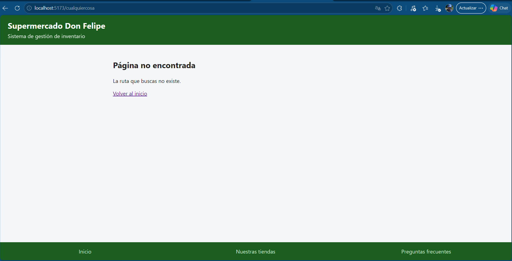
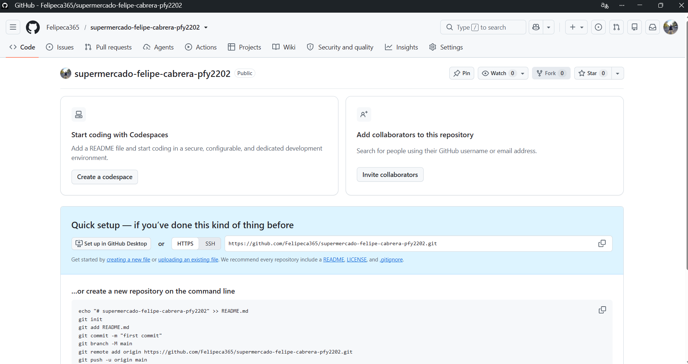

# Supermercado Don Felipe: Gestión de inventario

Evaluación Formativa 1 · Desarrollo Frontend II (PFY2202) · Duoc UC
**Autor:** Felipe Cabrera

Sitio web de gestión de inventario para un supermercado, desarrollado con **React**, **React Router** y **Vite**. Es una SPA (Single Page Application): la navegación entre pantallas no recarga la página.

## Tecnologías

- HTML, CSS y JavaScript
- React 19
- React Router DOM
- Vite (servidor de desarrollo y compilación)

## Cómo ejecutar el proyecto

Requisito: tener Node.js instalado.

```bash
npm install
npm run dev
```

Luego abrir `http://localhost:5173`.

## Rutas del sitio

| Ruta | Componente | Descripción |
|---|---|---|
| `/` | `Home` | Inventario con control de stock (botones + y −) |
| `/tiendas` | `Tiendas` | Sucursales, direcciones y horarios |
| `/preguntas-frecuentes` | `Faq` | Preguntas frecuentes desplegables |
| `*` | `NotFound` | Mensaje para rutas inexistentes |

## Estructura

```
src/
├── main.jsx            # BrowserRouter envuelve la aplicación
├── App.jsx             # Definición de rutas (Routes / Route)
├── App.css             # Estilos
├── components/
│   └── BottomNav.jsx   # Menú inferior con NavLink
└── pages/
    ├── Home.jsx
    ├── Tiendas.jsx
    ├── Faq.jsx
    └── NotFound.jsx
```

## Cumplimiento de la pauta de evaluación

**Criterio 1: Configura la navegación usando React Router**
- `BrowserRouter` en `main.jsx`.
- `Routes` y `Route` en `App.jsx`, incluida una ruta `*` para páginas no encontradas.
- `NavLink` en el menú inferior, que navega sin recargar la página y marca la sección activa.

**Criterio 2: Componente frontend que responde a todos los requerimientos**
- Sitio de gestión de inventario de supermercado.
- Página principal (home) y menú inferior con acceso a 2 páginas adicionales (Nuestras tiendas y Preguntas frecuentes).
- Repositorio en GitHub con el nombre `supermercado-felipe-cabrera-pfy2202`.

## Evidencias

**1. Instalación y ejecución (`npm install` y `npm run dev`)**


**2. Página principal: inventario**


**3. Ruta `/tiendas`.** Tras recargar con F5, el navegador vuelve a pedir la aplicación completa (se ve el documento `tiendas` en la pestaña Network).


**4. Ruta `/preguntas-frecuentes`.** Al navegar con el menú no se genera ninguna solicitud nueva (pestaña Network vacía), lo que demuestra el funcionamiento como SPA.


**5. Código de las rutas en `App.jsx`**


**6. Ruta inexistente (página 404)**


**7. Repositorio creado en GitHub**

